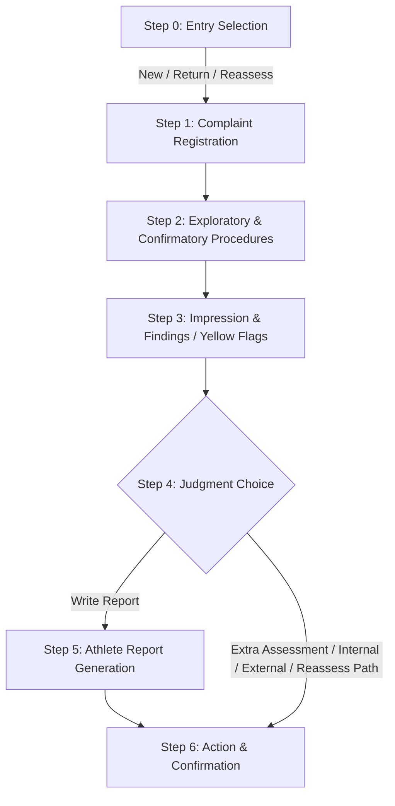
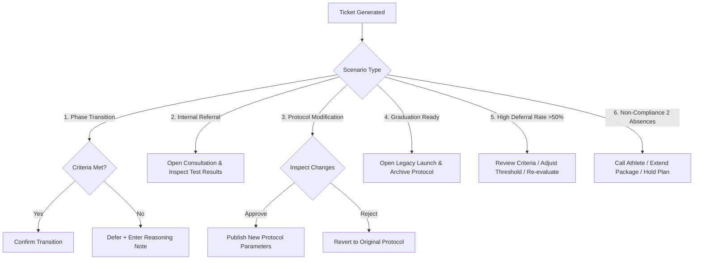

# Doctor Control Command Center — Comprehensive User Guide

Welcome to the **Doctor Control Command Center** (`DoctorControlComponent`). This portal serves as the centralized hub for physicians, specialists, and clinical team leads to monitor patient progress, execute consultation workflows, make rapid clinical decisions, approve protocol modifications, and manage athlete rehabilitation transitions.

---

## 📌 1. Command Center Overview & Architecture

The **Doctor Control Command Center** organizes clinical workflows into six integrated navigation and operational sections:

| Tab Icon | Tab / Module Name | Component Selector | Purpose & Core Responsibility |
| :---: | :--- | :--- | :--- |
| 📊 | **Dashboard** | `app-dc-dashboard` | High-level KPI oversight, today's appointment list, and immediate priority decision items. |
| 📅 | **Today's Consultations** | `app-dc-todays-consultations` | Weekly interactive appointment calendar grid, slot availability, and 2-week forecast. |
| 🎟️ | **Pending Tickets** | `app-dc-pending-tickets` | Main clinical decision queue for phase transitions, protocol edits, graduation reviews, and non-compliance alerts. Features a **Mock Data Toggle** (ON/OFF). |
| 🩺 | **Consultation Screen** | `app-consultation-screen` | 7-step interactive clinical consultation workflow for New, Returning, and Reassessment athletes. |
| 🔔 | **Notifications & Alerts** | `app-dc-notifications-alerts` | Live notification feed categorized by severity level with direct deep-linking to patient dossiers and protocols. |
| 🛠️ | **Protocol Builder** | `app-protocol-config` | 5-step wizard to design, modify, and publish clinical rehabilitation protocols. |

---

## 🗂️ 2. Sidebar Navigation (`dc-sidebar`)

The sidebar provides continuous access to the doctor profile and workspace tabs:

* **Physician Profile Card:** Displays the active logged-in doctor's name (*Dr. Hossam Zeidan*) and subtitle (*Doctor Command Center*).
* **Navigation Buttons:** Each menu item features:
  * **Icon & Status Dot:** Visual status indicator (e.g., 🟢 green active indicator for Dashboard).
  * **Dynamic Badges:** Live count badges showing unhandled items (e.g., `2` upcoming consultations, `4` pending tickets, `3` unread notifications).

---

## 📊 3. Feature 1: Dashboard (`app-dc-dashboard`)

The Dashboard provides immediate clinical governance over daily operations and priority cases.

### 3.1 Key Performance Metric (KPI) Cards
1. 📅 **Today's Consultations:** Total appointments scheduled for today, including remaining carryover appointments from yesterday.
2. 🎟️ **Pending Decisions:** Count of tickets awaiting physician sign-off.
3. 📊 **Clarity Score — NPS:** Client Net Promoter Score rating (Target range: 8.0–9.0).
4. ⚠️ **Negative Feedback:** Count of negative feedback reports received during the current week.

### 3.2 Today's Schedule List
Displays today's patient list with color-coded status badges:
* 🟢 **New:** First-time athlete initial consultation.
* 🟡 **Revise:** Follow-up revision appointment.
* 🔴 **Plan:** Full treatment plan re-evaluation.
* **Action:** Click **`Open Consultation`** on any row to open the active consultation workspace (`/uikit/consultation-type`).

### 3.3 Priority Action Queue ("Highest Priority — Needs Your Decision")
Displays urgent clinical tickets directly on the dashboard:
* **`Open Consultation`**: Directly launches the patient's consultation form.
* **`View Changes`**: Opens the protocol modification viewer to inspect proposed exercise adjustments.
* **`Approve` / `Reject`**: Confirms or reverts team-leader protocol modifications.

---

## 📅 4. Feature 2: Today's Consultations Calendar (`app-dc-todays-consultations`)

An interactive calendar grid designed for managing daily appointment schedules and forecasting capacity.

### 4.1 Date Navigation & Range Selection
* **`◄ Prev Week`**: Navigates 7 days backward in the calendar.
* **`Next Week ►`**: Navigates 7 days forward.
* **Active Week Header:** Displays the formatted weekly date range (e.g., *Aug 14 – Aug 20*).

### 4.2 Daily Calendar Grid (Monday – Sunday)
Time slots are represented with color-coded status indicator dots:
* 🟢 **Green:** Confirmed & ready slot.
* 🟡 **Yellow:** Pending / waiting athlete.
* 🔴 **Red:** Urgent attention required.
* 🔵 **Blue:** Special plan appointment.
* 🔘 **Gray:** Completed / archived session.

### 4.3 Next 2 Weeks Forecast
Below the main calendar grid, a summary panel forecasts upcoming consultation load for the next 2 weeks to aid clinical resource planning.

---

## 🎟️ 5. Feature 3: Pending Tickets Decision Queue (`app-dc-pending-tickets`)

The central decision queue for evaluating clinical progress, phase transitions, and protocol modifications.

### 5.1 Data Source Toggle Button (Mock Data vs Live API)
Located at the top right of the Pending Tickets section:
* 🔘 **OFF (Default):** Fetches real-time pending tickets from the backend server API (`/api/PendingTickets`).
* 🟢 **ON (Mock Data):** Loads the 6 representative clinical scenarios for testing and demonstration without modifying live backend data.
* **Status Badge:** A dynamic badge in the sort header indicates `Live API Data` (blue server icon) or `Mock Data` (yellow info icon).

### 5.2 Queue Filter Tabs
1. **Needs your decision:** Shows tickets requiring explicit doctor authorization or clinical approval.
2. **Urgent alerts:** Filters down to critical timeout and non-compliance alerts.
3. **All tickets:** Displays all tickets sorted by urgency level (Urgent first) and creation date descending.

---

## 🩺 6. Feature 4: Consultation Screen Workflow (`app-consultation-screen`)

The **Consultation Screen** provides a guided 7-step clinical workflow (Step 0 to Step 6) for executing consultations, diagnosing conditions, ordering tests, and defining rehabilitation plans.

### 📁 6.1 Patient Dossier Sidebar ("Open Patient File")
Available in the left sidebar throughout all consultation steps:
* Click **`Open Patient File`** to launch the comprehensive athlete profile dialog (`openPatientProfileDialog()`).
* **Consolidated Dossier Tabs:**
  1. **Personal Data:** Initials, contact, booking origin.
  2. **Sports Data:** Primary sport, position, skill level, training frequency.
  3. **Injury Data:** Current injury details, side, onset, previous interventions.
  4. **Medical History:** Chronic conditions, medications, allergies.
  5. **Injury History:** Historical injuries & surgical history.
  6. **Social Profile:** Work nature, marital status, lifestyle habits.

---

### 📋 6.2 Step-by-Step Consultation Flow

#### **Step 0 — Consultation Type Selection**
The physician selects one of three consultation entry modes:
1. 🟢 **New Athlete (Full Blueprint):**
   * First visit. Initiates full diagnostic sequence: *Complaint ➔ Exam ➔ Impression ➔ Judgment ➔ Report ➔ Action*.
   * Verifies Data Map completion & payment confirmation.
2. 🟡 **Returning Athlete (Validity Check):**
   * System automatically checks Data Map validity (12-month window).
   * **If Valid:** Discounted consultation without repeating the Blueprint (fee waived; loads prior clinical history).
3. 🔴 **Reassessment (Active Program):**
   * For athletes currently enrolled in a rehabilitation program experiencing a new injury or symptom escalation.
   * Offers 4 specialized re-evaluation pathways:
     * **Path A — Edit Protocol:** Modify current protocol without pausing.
     * **Path B — Pause + Investigate:** Freeze sessions for diagnostic investigation.
     * **Path C — Replace Protocol:** Close current protocol, transfer credit, launch new protocol.
     * **Path D — Parallel Protocol:** Run secondary protocol simultaneously.

---

#### **Step 1 — Complaint Registration**
Captures subjective symptoms and functional impact:
* **Clinical Complaint:** Patient's complaint recorded in their exact words.
* **Functional Impact Rating:** 3-point severity dropdowns for:
  1. *Training Impact* (None, Mild, Moderate, Severe, Unable)
  2. *Competition Impact*
  3. *Daily Life Impact*
  * *Additional Impact Comment* box for context.
* **Onset & Aggravating Factors:**
  * Onset Date selection (automatically calculates **Days Since Onset**).
  * Aggravating triggers (e.g. running, prolonged sitting, stair climbing).

---

#### **Step 2 — Exploratory & Confirmatory Procedures & Subjective Observation**
Objective physical examination and pain assessment:
* **Exploratory & Confirmatory Procedures List:**
  * Dynamic rows (`+ Add Procedure`): Input procedure name and clinical result (e.g., *Lachman Test ➔ Grade II laxity*).
* **Subjective Observations:**
  * **VAS Pain Score:** 0–10 visual analog scale.
  * **Effusion Rating:** Dropdown rating (None, Trace, Mild, Moderate, Severe).
  * **Asymmetry %:** Percentage strength or range-of-motion deficit.

---

#### **Step 3 — Impression & Findings (Yellow Flags & Behavioral Signals)**
Clinical findings and risk assessment:
* **Findings:**
  * *Dysfunctions & Risk Factors* (mandatory text input).
  * *Strengths Observed* & *Weaknesses Observed*.
* **Notes & General Impression:** Session overview and file notes.
* **Yellow Flag Score (Psychological Risk Assessment):**
  * 5-item checklist: Fear-avoidance beliefs, catastrophizing, anxiety, unrealistic recovery expectations, social stress.
  * **Automated Alert:** If Yellow Flag score is **≥ 3 / 5**, a prominent amber banner highlights: *"Yellow Flag Alert: Athlete needs intensive psychological follow-up."*
* **Behavioral Signals (Internal Only — Hidden from Client):**
  * *Emotional Trigger ("Why now?"):* E.g., upcoming competition, coach pressure.
  * *Experience with Previous Providers:* Track past medical history/frustrations.
  * *Expectations & Biggest Fear:* E.g., fear of surgery, cost, or slow recovery.
  * *Compliance Index & Persona Classification:* High/Medium/Low compliance expectation.
  * *Purchase Influencer:* Identifies who drives treatment decisions (Athlete, Parent, Coach, Agent).

---

#### **Step 4 — Judgment & Path Selection**
The physician selects the clinical decision pathway:

##### **Choice A: Write Report**
Diagnosis is clear. The doctor fills in:
* **General Opinion:** Overall clinical perspective and recommendation.
* **Diagnosis:** Primary diagnosis text, Grade (Grade I, II, III), Phase (Acute, Subacute, Chronic), and clinical exam notes.
* **Therapeutic Goal:** Primary goal (e.g., *Return to Play LSI > 90%*), expected duration (e.g., *12–16 weeks*), and goal category.

##### **Choice B: Extra Assessment / Diagnostic Referral**
More diagnostic data is needed before proceeding:

* **For New / Returning Athletes:**
  1. 🟢 **Direct Blueprint:** Proceeds directly to protocol creation (`CLIENT_APPROVED`).
  2. 🟡 **Internal Measurements:** Creates a lab test ticket for internal engineers (Select: Measurement Type, Side [Left/Right/Bilateral], Test Date).
  3. 🔴 **External Referral:** Orders external imaging (MRI, X-Ray, CT). Captures Specialty, Test Region, Purpose, Recommendation Doctor & Mobile Number, and Follow-up flag. Automated reminder triggers on Days 2, 5, 10, and 30.

* **For Reassessment Athletes (Active Program Intervention):**
  * 🟢 **Path A (Edit Protocol):** Opens active protocol in edit mode; logs changes in Audit Trail.
  * 🟡 **Path B (Pause + Investigate):** Sets status to `PROGRAM_PAUSED`; captures Pause Reason, Investigation Type (MRI, Specialist Consultation), and Expected Duration.
  * 🔴 **Path C (Replace Protocol):** Closes current protocol (`REPLACED_BY_REASSESSMENT`); transfers remaining session balance to new protocol builder.
  * 🟣 **Path D (Parallel Protocol):** Keeps existing protocol active; launches a second protocol simultaneously (e.g., Knee + Shoulder).

---

#### **Step 5 — Athlete Report Generation** (When *Write Report* is selected)
Defines the client-facing and internal rehabilitation blueprint:
* **Recommended Service / Track:** Interactive selection cards (e.g., *ACL Rehabilitation Track*, *Performance Enhancement*).
* **Priority / Urgency Level:** High, Medium, Low.
* **Program Duration & Frequency:** Duration dropdown (e.g., 4, 8, 12 weeks) or Custom frequency (sessions/week).
* **Plan Phases Table (Internal Only):** Dynamic phase builder table:
  * *Phase Name* (e.g., Phase 1: Pain Control)
  * *Goal* (e.g., Restore full ROM)
  * *Transition Criteria* (e.g., LSI ≥ 85%, Pain VAS ≤ 2)
  * *Session Count*
* **Sports Recommendations (Client-Visible):** Clear guidelines for the athlete (e.g., *Resume light jogging after Phase 2*).
* **Team Notes (Internal Only):** Confidential notes for physical therapists and strength coaches.

---

#### **Step 6 — Action & Final Confirmation**
Final execution step:
* **Decision Notes:** Input mandatory summary notes accompanying the final decision.
* **Confirmation Execution:**
  * Click **`Confirm`** / **`Open Protocol Builder`** / **`Confirm Pause`**.
  * Executes backend state changes (e.g., status updates to `CLIENT_APPROVED`, `PENDING_INTERNAL`, `PENDING_EXTERNAL`, or `PROGRAM_PAUSED`).
  * Dispatches automated system notifications to team leaders, engineers, and athletes.

---

## 🔄 7. Athlete Transition & Clinical Governance Workflows

The system manages 6 standardized clinical decision scenarios:

### Workflow 1: Phase Transition Confirmation (Progress Advancement)
* **Trigger:** Athlete meets or fails phase criteria thresholds (LSI %, VAS score, ROM °).
* **Conditions & Actions:**
  * **If Criteria Met:** Click **`Approve Transition`** / **`Confirm Transition`** to advance athlete to the next rehabilitation phase.
  * **If Criteria NOT Met:** Click **`Defer`**. A modal prompts the doctor to input a mandatory **Reasoning Note** explaining why transition is postponed. Submitting dispatches notifications to physical therapists.

### Workflow 2: Internal Referral → Re-visit Consultation
* **Trigger:** Internal referral measurements (Isokinetic strength, balance, ROM) are completed by testing specialists.
* **Action:** Click **`Open Consultation`**. The consultation form displays green completion checkmarks (`✓`) next to completed measurement tests.

### Workflow 3: Team Leader Protocol Modification
* **Trigger:** A Team Leader modifies exercises, resistance, or sets in an active treatment plan.
* **Action:** Click **`View Changes`** to review diffs.
* **Decision:**
  * Click **`Approve`** to accept changes and update the active protocol.
  * Click **`Reject` (`Revert`)** to discard edits and revert to the previous version. Both actions notify the Team Leader.

### Workflow 4: Completed Protocol → Graduation Ready
* **Trigger:** Athlete completes all prescribed phases and passes graduation benchmarks.
* **Action:** Click **`Open Legacy Launch`** (`/uikit/phases-sessions`) to conduct the final exit evaluation, archive the protocol, and transition the athlete to athletic maintenance.

### Workflow 5: High Deferral Rate Escalation (> 50% Timeout)
* **Trigger:** Athlete has been deferred in > 50% of transition attempts or exceeded expected phase duration by > 50%.
* **Available Interventions:**
  * **`Review Criteria`:** Opens protocol configuration to inspect phase entry/exit thresholds.
  * **`Adjust Threshold`:** Modifies progression targets for this athlete; alerts clinical staff.
  * **`Request Measurement`:** Orders new objective measurement tests.
  * **`Re-evaluate`:** Schedules a full clinical re-assessment appointment.

### Workflow 6: Attendance & Non-Compliance (2 Consecutive Absences)
* **Trigger:** Athlete misses 2 consecutive scheduled sessions or compliance rate drops below 50%.
* **Escalation Actions:**
  1. 📞 **`Call Athlete`**: Triggers administrative outreach.
  2. ⏩ **`Extend Package`**: Dispatches a warning notification to the athlete and steps back 1 stage in the active protocol.
  3. ⏸️ **`Hold Plan`**: Places the plan on **Hold** (Inactive status) and freezes package validity.

---

## 🔔 8. Feature 5: Notifications & Alerts (`app-dc-notifications-alerts`)

Real-time notification engine with color-coded severity tiers and deep-linking.

### 8.1 Severity Tiers & Visual Coding
* 🔴 **Critical:** Low NPS ratings (<6), negative session feedback, escalated referrals.
* 🟡 **Warning:** Low blueprint rating, 2-day / 5-day referral follow-up reminders.
* 🟣 **Protocol:** Pending protocol modifications, plan appointment ready.
* 🟢 **Success:** Noticeable improvement alerts, payment confirmation.
* 🔵 **Info:** Standard system announcements.

### 8.2 Management & Deep Link Navigation
* **`Mark All Read`**: Marks all active notifications as read.
* **Click-to-Navigate:**
  * *Appointment alerts* ➔ Navigates directly to Consultation Form (`/uikit/appointment-consultation-form/:id`).
  * *Treatment Plan / Protocol alerts* ➔ Opens Phases & Sessions (`/uikit/phases-sessions`).
  * *Athlete alerts* ➔ Opens Athlete Profile (`/uikit/athleteprofile`).

---

## 🛠️ 9. Feature 6: Protocol Builder (`app-protocol-config`)

A 5-step wizard for creating and publishing rehabilitation protocols:

1. **Step 1: Protocol Information:** Basic metadata (name, target injury, age group, sport).
2. **Step 2: Phases & Criteria:** Define rehabilitation phases and threshold criteria (LSI %, ROM °).
3. **Step 3: Sessions & Exercises:** Configure exercise routines, sets, reps, and rest periods.
4. **Step 4: FITT-VP Revision:** Fine-tune Frequency, Intensity, Time, Type, Volume, and Progression.
5. **Step 5: View & Review:** Final clinical review and publish command.

---

## 📋 10. Quick Reference Decision Matrix

| Module / Scenario | Trigger Condition | Primary Doctor Action | System Outcome |
| :--- | :--- | :--- | :--- |
| **New Athlete Consultation** | First visit | Complete Steps 0 ➔ 6 | Generates Blueprint; opens Protocol Builder. |
| **Return Athlete Consultation** | Data Map valid (<12m) | Start Flow (No Blueprint) | Waives fee; loads prior history. |
| **Reassessment Consultation** | Symptom escalation | Select Path A, B, C, or D | Edits, pauses, replaces, or runs parallel protocol. |
| **Yellow Flag Alert** | YF Score ≥ 3 / 5 | Add psychological support | Displays amber alert; flags profile internally. |
| **Internal Measurement** | Need lab testing | Choice B ➔ Select Test | Creates ticket for testing engineer. |
| **External Referral** | Imaging required | Choice B ➔ Referral Form | Sends instructions; sets 2/5/10/30 day reminders. |
| **Phase Transition** | Phase criteria met | `Approve Transition` | Advances athlete to next phase. |
| **Phase Deferral** | Criteria incomplete | `Defer` + Reasoning Note | Holds phase; dispatches alert to PT staff. |
| **Protocol Modification** | Team Lead submits edits | `Approve` / `Reject` | Updates active protocol or reverts version. |
| **Mock Data Toggle** | Switch ON/OFF | Toggle switch in header | Loads test scenarios (ON) or live server API (OFF). |

---
*Doctor Control Command Center User Guide — Version 2.5*
